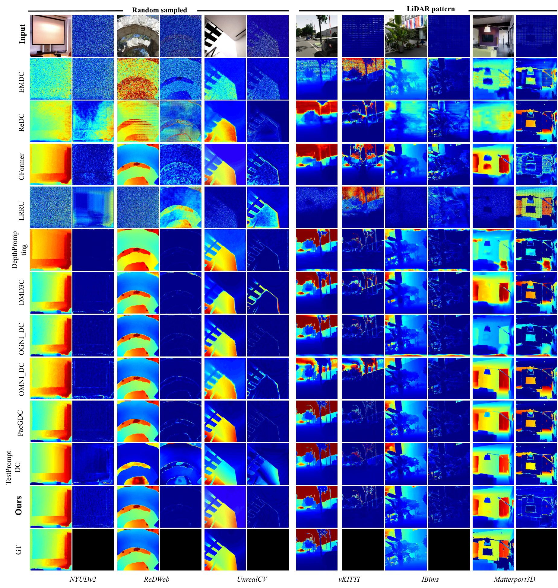
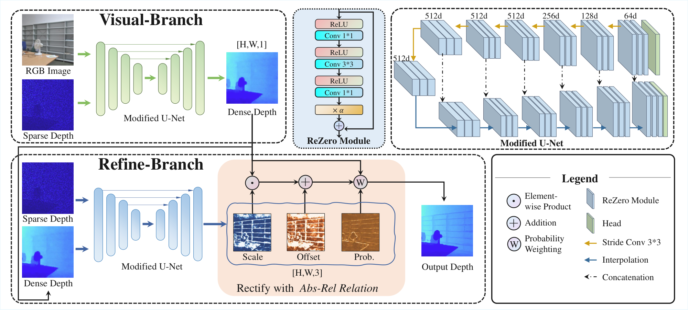
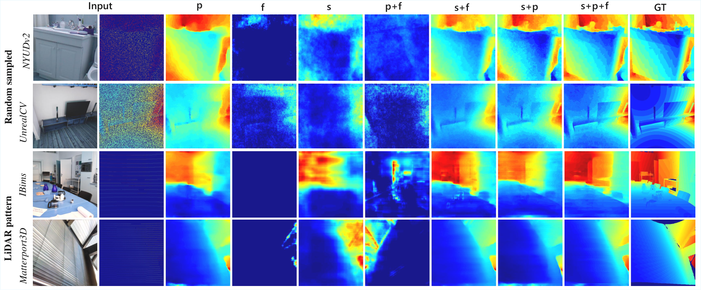

<div align="center">

# JARRN

### Joint Absolute-Relative Relation Network for Robust Depth Completion

<h2>IEEE TCSVT 2026</h2>

**Bingyuan Chen**<sup>†</sup> ([**@Alex-Lord**](https://github.com/Alex-Lord)) · **Ruizhe Zhang**<sup>†</sup> ([**@zddd618**](https://github.com/zddd618)) · **Meng Yang** · **Nanning Zheng**

<sup>†</sup> Equal contribution (co-first authors).

<strong>ROBUST ZERO-SHOT<br>GENERALIZATION<br>ACROSS DIVERSE SCENES</strong>

Training code and paper figures for a two-branch depth completion network.

[Abstract](#abstract) · [Architecture](#architecture) · [Model weights](#model-weights) · [Training](#training)

</div>

<p align="center">
  
</p>

---

## Abstract

Depth completion estimates a dense depth map from an RGB image and sparse depth measurements. Models trained on one scene often struggle to generalize because absolute distance and relative scene geometry impose different constraints. JARRN combines both through two sequential branches: a visual branch predicts dense depth, while a refine branch learns scale, offset and probability maps to correct it. Training combines absolute and standardized relative depth losses with a multi-scale gradient loss. This repository provides the standalone **training code**, network diagrams and qualitative examples.

## Architecture

<p align="center">
  
</p>

The visual branch uses RGB and sparse depth to predict $D_v$. The refine branch estimates scale $S$, offset $F$ and probability $P$, producing the final depth:

$$
\hat D = P \odot (S \odot D_v + F) + (1-P) \odot D_v.
$$

<details>
<summary><b>Explore the learned refinement maps</b></summary>

<p align="center">
  
</p>

The scale, offset and probability components contribute complementary corrections to dense depth.

</details>

## Model weights

The original model weights remain available from **[Google Drive](https://drive.google.com/drive/folders/1uWVAgbockgQOVohXyKIJXbiX89tdUUvA?usp=sharing)**. Checkpoints and training datasets are hosted separately from this code repository.

## Training

### Installation

Use Python 3.10+ and PyTorch 2.3+. Install a PyTorch build for your CUDA version, then install the remaining requirements:

```bash
pip install -r requirements.txt
```

### Data layout

The loader pairs RGB images and ground-truth depth maps by relative path and filename stem:

```text
DATA_ROOT/
├── DIODE/train/
│   ├── DIODE_rgb/.../example.png
│   └── DIODE_gt/.../example.png
└── HRWSI/train/
    ├── HRWSI_rgb/.../example.jpg
    └── HRWSI_gt/.../example.png
```

Supply one `--data-root` for each training split. Hole-mask PNGs can be supplied with `--hole-root`; without them, the loader still synthesizes sparse depth from ground truth.

### Single GPU

```bash
python train.py \
  --data-root /path/to/DIODE/train \
  --data-root /path/to/HRWSI/train \
  --hole-root /path/to/Hole_Dataset \
  --save-dir runs/jarrn --rezero
```

### Multiple GPUs

```bash
torchrun --standalone --nproc_per_node=4 train.py \
  --data-root /path/to/DIODE/train \
  --data-root /path/to/HRWSI/train \
  --hole-root /path/to/Hole_Dataset \
  --batch-size 8 --save-dir runs/jarrn --rezero
```

Defaults: 60 epochs, 320 × 320 crops, AdamW, learning rate `2e-4`, and a factor-of-two reduction after epochs 20 and 40. `--batch-size` is **per GPU**. Checkpoints and training logs are written to `runs/jarrn/`.

Resume by specifying the checkpoint and the desired **total** number of epochs:

```bash
python train.py \
  --data-root /path/to/DIODE/train \
  --data-root /path/to/HRWSI/train \
  --resume runs/jarrn/epoch_020.pt \
  --epochs 60 --save-dir runs/jarrn --rezero
```

Run `python train.py --help` for all options.

## Repository contents

| Path | Purpose |
| --- | --- |
| [`train.py`](train.py) | Training, distributed setup and checkpointing |
| [`jarrn/model.py`](jarrn/model.py) | Visual and refine branches |
| [`jarrn/data.py`](jarrn/data.py) | Paired image loading and sparse-depth synthesis |
| [`jarrn/losses.py`](jarrn/losses.py) | Absolute, relative and multi-scale gradient losses |
| [`assets/`](assets) | Architecture and qualitative illustrations |

## Contributors

Paper authors: Bingyuan Chen, Ruizhe Zhang, Meng Yang and Nanning Zheng. Repository contributors: [Alex-Lord](https://github.com/Alex-Lord) and [zddd618](https://github.com/zddd618).
